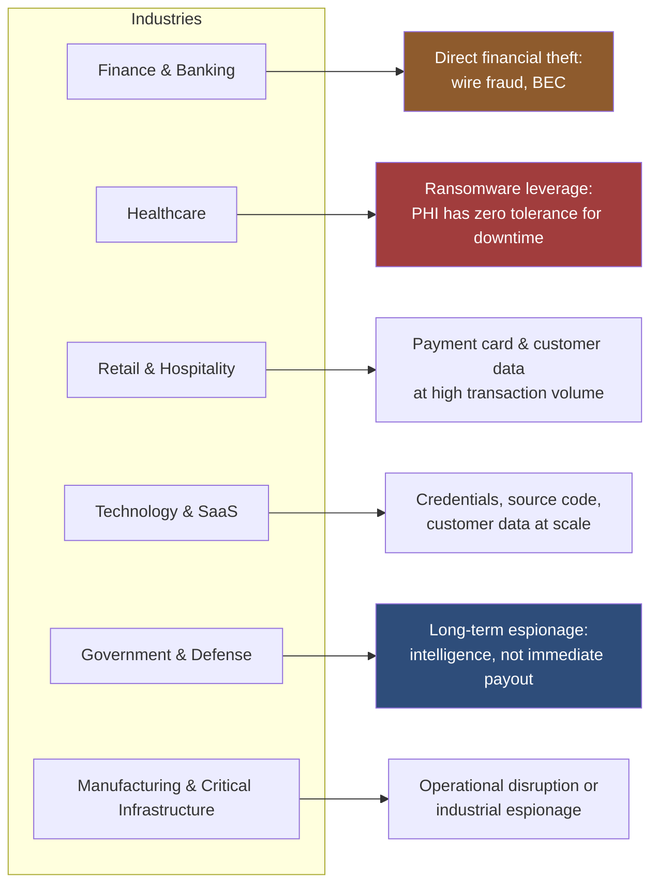

# 02 — Goals by Industry

## Why "the goal" changes everything downstream

A common mistake in security awareness training is treating social engineering as one generic threat with one generic defense: "don't click suspicious links." That advice doesn't survive contact with reality, because what an attacker is trying to achieve varies enormously by industry, and the goal determines the entire shape of the attack: who gets targeted first, what channel is used, how patient the attacker is willing to be, and what "success" even looks like to them.

An attacker targeting a hospital for ransomware and an attacker targeting a defense contractor for espionage are not the same attacker with a different target. They're running fundamentally different playbooks, on different timelines, with different tolerance for being detected.

## The mapping

## The reasoning behind each one

**Finance & Banking — direct financial theft.** The goal is usually the most literal one in this entire list: move money, now. Business Email Compromise (BEC), where an attacker impersonates an executive or vendor to redirect a wire transfer, remains one of the highest-dollar-loss cybercrime categories reported to the FBI's Internet Crime Complaint Center year after year, specifically because the "product" being stolen is liquid cash, not data that needs to be resold. This pushes attackers toward urgency-based pretexts (an approaching deadline, a confidential acquisition) aimed squarely at the finance department, not IT.

**Healthcare — ransomware leverage, not just data theft.** Patient data is valuable to steal, but the far more common goal in recent years has been ransomware, specifically because hospitals have an unusually low tolerance for system downtime — a locked electronic health record system isn't just an inconvenience, it can delay actual patient care. That asymmetry (extreme cost of downtime vs. moderate cost of paying) is precisely what makes healthcare a preferred ransomware target, and phishing remains the dominant entry vector because clinical staff are trained to prioritize patient responsiveness over security friction.

**Retail & Hospitality — payment data at volume, or full network access.** Retail attacks historically centered on payment card data, extracted at scale from point-of-sale systems (see the Target case study in Section 03). More recently, as in the MGM/Caesars case studies, the goal has shifted toward full network compromise for ransomware, because hospitality environments run on availability (reservations, room access, payment processing all failing at once creates massive, immediate leverage). Both goals tend to start the same way: through a vendor or a help desk, because retail and hospitality environments have unusually wide third-party access footprints (POS vendors, booking platforms, delivery services).

**Technology & SaaS — credentials and access at scale.** A single compromised employee credential at a company that provides authentication or communication infrastructure to other companies doesn't just expose one organization, it exposes every downstream customer (this is exactly the mechanism in the Twilio case study). The goal here is rarely the direct target's data alone; it's using the target as a stepping stone into its customers, which is what makes tech and SaaS companies specifically attractive as a *pivot point* rather than a final destination.

**Government & Defense — long-horizon espionage.** Unlike financially motivated attackers, nation-state-aligned actors optimize for durable, undetected access over months or years, not a fast payout. Spear-phishing here is slower, more researched, and far more patient (see the RSA case study, where the ultimate objective appeared to be reaching downstream defense contractors, not RSA itself). Success is measured in sustained intelligence access, which changes the entire risk calculation: a nation-state actor will happily spend months on reconnaissance that a financially motivated criminal group would consider a waste of time.

**Manufacturing & Critical Infrastructure — disruption or industrial espionage.** Operational technology (OT) environments (industrial control systems, SCADA) are frequently air-gapped or segmented from corporate IT specifically because their goal profile is different again: either steal proprietary industrial processes, or cause physical-world disruption. Because OT systems are often old, rarely patched, and extremely sensitive to unplanned downtime, the social engineering angle here typically targets the corporate IT side first, using it as a bridge into OT rather than attacking OT directly — which is exactly the segmentation problem addressed at length in a companion project on network architecture.

## The pattern underneath all six

In every case, the attacker's *first move* is shaped entirely by what they're ultimately after. This is why "the same generic phishing training" fails: a bank teller, a hospital nurse, and a defense contractor engineer are being targeted with different pretexts, different urgency levels, and different acceptable failure rates, because the payoff at the end of each path is different. Effective defense has to account for that instead of treating every employee as facing an identical, generic threat.

---
**Previous:** [← 01 — Foundations of Social Engineering](../01-foundations-of-social-engineering/README.md)
**Next:** [03 — Real-World Escalation Case Studies →](../03-real-world-escalation-case-studies/README.md)
