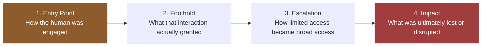

# 03 — Real-World Escalation Case Studies

## Why these six

Every incident below is real and publicly documented — through the affected company's own breach disclosures, regulatory filings, or reporting from established security and technology outlets. They were chosen specifically because each one shows the same underlying pattern this project is built around: a social engineering interaction that a reasonable, competent employee could plausibly fall for, followed by a technical escalation that turned one person's mistake into an organization-wide breach.

They span six different industries and five different initial vectors deliberately, to demonstrate that this is not a phishing-email problem. It's a trust problem, and it takes whatever shape the target's environment makes easiest.

## The shared analysis framework

Each case study is broken into the same four stages, borrowed from the standard cyber kill chain model, so the pattern across incidents is easy to compare:

The reason this structure matters: almost every post-incident conversation focuses entirely on stage 1 ("they clicked a link") and almost never on stages 2 through 4, which is exactly where the real, preventable damage happens. A phishing click that leads nowhere is a non-event. A phishing click that leads to unsegmented, over-privileged access to the entire network is a headline. The difference between those two outcomes is almost never about the phishing email. It's about everything the defender built (or didn't build) after the click.

## The cases

| Case | Industry | Entry Vector | Escalation Mechanism |
|---|---|---|---|
| [Target (2013)](target-2013-vendor-phishing-to-pos-breach.md) | Retail | Phishing (third-party vendor) | Flat vendor network access → point-of-sale malware |
| [RSA (2011)](rsa-2011-spearphish-to-securid-seed-theft.md) | Security / Defense supply chain | Spear-phishing email (malicious attachment) | Malware foothold → lateral movement → seed data exfiltration |
| [Twitter (2020)](twitter-2020-vishing-to-account-takeover.md) | Social media / Technology | Vishing (phone-based) | Employee credential harvest → internal admin tool abuse |
| [Twilio "0ktapus" (2022)](twilio-2022-smishing-oktapus-campaign.md) | Communications / Technology | Smishing (SMS-based) | Credential phishing at scale → downstream customer exposure |
| [Uber (2022)](uber-2022-mfa-fatigue-contractor-compromise.md) | Technology / Rideshare | MFA fatigue + purchased credentials | Contractor account compromise → hardcoded credentials on internal share |
| [MGM Resorts & Caesars (2023)](mgm-caesars-2023-helpdesk-vishing-ransomware.md) | Hospitality / Gaming | Vishing (help desk impersonation) | Identity reset → privileged access → ransomware deployment |

## How to read these

Read for the *escalation* stage specifically, not just the opening hook. The entry point is almost always mundane. The lesson is never "employees should be smarter." It's "what should have stopped this at stage 2 or 3, and why didn't it."

---
**Previous:** [← 02 — Goals by Industry](../02-goals-by-industry/README.md)
**Next:** [04 — Defensive Measures →](../04-defensive-measures/README.md)
