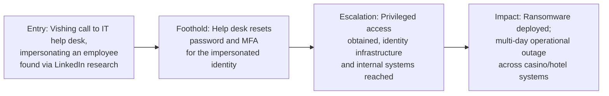

# MGM Resorts & Caesars Entertainment (2023) — Help Desk Vishing to Ransomware

**Industry:** Hospitality / Gaming
**Disclosed impact:** MGM reported the incident caused a multi-day, company-wide operational outage (hotel reservations, digital room keys, slot machines, and casino systems) and disclosed roughly $100 million in related costs; Caesars disclosed a ransom payment and a breach of customer loyalty program data.

## In plain terms

A group of attackers, publicly tracked under the name Scattered Spider, researched an employee's public professional profile, then called the company's IT help desk pretending to be that employee, locked out and needing a password and multi-factor authentication reset. The help desk, following what looked like a normal identity-verification process, reset the credentials. That reset handed the attackers a working identity inside the company, which they escalated into ransomware deployment across systems controlling everything from hotel key cards to slot machines.

## Stage-by-stage breakdown

**1. Entry Point.** According to public reporting and MGM's and Caesars' own regulatory disclosures, the attacker group identified an employee using LinkedIn and other publicly available professional information, then called the company's IT help desk, impersonating that employee and reporting an inability to log in.

**2. Foothold.** The help desk, working from what was described publicly as a standard identity-verification process that relied on information an attacker could plausibly obtain through research or a confident, well-rehearsed phone manner, reset the impersonated employee's password and multi-factor authentication method, effectively handing the attacker a fully working identity.

**3. Escalation.** With that identity, the attackers moved into internal systems and are reported to have reached identity and access management infrastructure, expanding their reach well beyond a single account and toward broader administrative control across affected environments.

**4. Impact.** At MGM, the resulting incident forced a company-wide shutdown of numerous systems for several days, including hotel reservation systems, digital room key generation, and slot machines across its properties; MGM's subsequent SEC filing disclosed a cost impact of approximately $100 million, along with the theft of some customer personal information. Caesars, targeted by the same group using a similar social engineering approach against an outsourced IT support vendor, disclosed a breach of its customer loyalty program database and confirmed paying a ransom to the attackers, reportedly around half the amount initially demanded, in an effort to prevent the stolen data from being released.

## What should have stopped this, and where it's covered

- **A verification protocol for help desk identity resets that cannot be satisfied by information available on LinkedIn or a confident phone manner alone** — for example, a callback to a number already on file, or verification through a channel the attacker cannot also control. This is the single most important lesson from this case. See [verification protocols](../04-defensive-measures/README.md#human-and-process-controls).
- **Segmentation limiting how far a single reset identity, even a legitimate one, can reach without additional step-up verification for high-privilege actions.** See [least privilege and blast-radius reduction](../04-defensive-measures/README.md#technical-controls).
- **Extending the same verification rigor to outsourced/third-party IT support vendors**, since the Caesars intrusion specifically routed through an external support vendor rather than internal staff.

## Why this case earns its place here

MGM and Caesars, hit by the same attacker group within roughly the same window using close variations of the same technique, are the clearest possible demonstration that no amount of employee security awareness training helps if the actual point of failure is a help desk process that will reset anyone's credentials given a confident voice and a name found on a public profile. The employees targeted here were not the ones with the vulnerability. The verification procedure was.

---
**Back to:** [03 — Real-World Escalation Case Studies](README.md)
