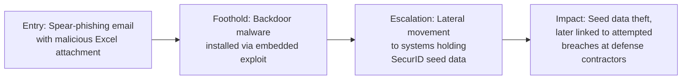

# RSA (2011) — Spear-Phishing to SecurID Seed Theft

**Industry:** Security / Defense supply chain
**Disclosed impact:** Theft of data related to RSA's SecurID two-factor authentication seed values, later linked to intrusion attempts against defense contractors relying on SecurID tokens.

## In plain terms

Two small groups of RSA employees received an email with the subject line "2011 Recruitment Plan" and an Excel spreadsheet attached. It wasn't sent to executives or IT administrators — ordinary staff, low enough profile that nobody expected to be a target. Opening the attachment triggered a hidden exploit that silently installed a backdoor. From that single foothold, attackers spent time moving quietly through RSA's network before finding and exfiltrating data connected to the SecurID product used by banks, governments, and defense contractors worldwide to secure remote access.

## Stage-by-stage breakdown

**1. Entry Point.** Two separate small groups of employees, none in particularly senior or privileged roles, received a spear-phishing email over two days with the subject "2011 Recruitment Plan," carrying an Excel file with an embedded exploit. Only one employee needed to open it for the attack to succeed, and one did.

**2. Foothold.** The embedded exploit installed a remote access backdoor associated with the Poison Ivy remote administration tool, giving the attacker a persistent, low-visibility presence on that single employee's machine.

**3. Escalation.** From that initial machine, the attacker moved laterally through RSA's network over a period of time, escalating privileges and locating systems associated with the SecurID product's seed record data — the cryptographic material underlying how SecurID tokens generate their one-time codes. RSA later confirmed this data was extracted from its network.

**4. Impact.** The stolen data was subsequently linked, according to public reporting, to attempted intrusions against U.S. defense contractors, including Lockheed Martin, which relied on SecurID tokens for secure remote access. RSA offered to replace SecurID tokens for enterprise customers as part of its remediation, at a reported cost in the tens of millions of dollars, and the incident remains a foundational case study in supply-chain risk: the actual intended targets were not RSA's employees, but the organizations that trusted RSA's product.

## What should have stopped this, and where it's covered

- **Attachment/macro execution controls** — restricting or sandboxing untrusted spreadsheet attachments would have blocked the embedded exploit from executing. See [technical controls](../04-defensive-measures/README.md#technical-controls).
- **Network segmentation isolating the most sensitive data** — seed data of this sensitivity warrants a network boundary well beyond standard corporate access. See [network segmentation](../04-defensive-measures/README.md#technical-controls).
- **Behavioral/anomaly detection for lateral movement** — a low-privilege workstation reaching toward highly sensitive internal systems is a detectable pattern given adequate monitoring.

## Why this case earns its place here

RSA demonstrates that social engineering doesn't need to target the "obvious" high-value employee. The attackers deliberately chose ordinary staff, betting correctly that lower perceived risk meant lower scrutiny. It's also the clearest example in this collection of a supply-chain attack: the ultimate targets were RSA's customers, reached through RSA, reached through two employees who had no reason to think they were interesting targets at all.

---
**Back to:** [03 — Real-World Escalation Case Studies](README.md)
