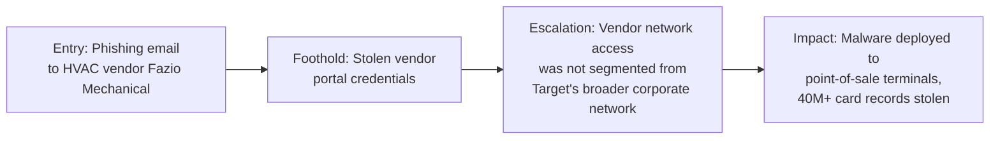

# Target (2013) — Vendor Phishing to Point-of-Sale Breach

**Industry:** Retail
**Disclosed impact:** Roughly 40 million payment card records and 70 million customer records stolen, during the peak holiday shopping season.

## In plain terms

Attackers didn't breach Target directly. They breached a small HVAC and refrigeration contractor that did business with Target, using a phishing email to steal that contractor's credentials. Those credentials, meant only for billing and project management, turned out to open a door that led all the way to Target's payment terminals — because nobody had ever seriously asked "what's the worst this vendor account could reach?"

## Stage-by-stage breakdown

**1. Entry Point.** Attackers sent a phishing email to employees at Fazio Mechanical, a refrigeration and HVAC contractor that had remote access to Target's vendor systems for billing, contract submission, and project management purposes. The email delivered credential-stealing malware.

**2. Foothold.** With Fazio's stolen credentials, attackers gained access to a Target vendor portal. This access was intended for narrow, administrative business functions — nothing related to payment processing.

**3. Escalation.** This is the stage that turned a vendor credential theft into a national breach. According to Target's own post-incident disclosures and subsequent congressional testimony, the vendor-facing network was not adequately isolated from Target's broader internal network. Attackers were able to move from the vendor portal into internal systems, and ultimately onto the network segment connected to point-of-sale (POS) terminals, where they installed malware designed to scrape payment card data directly from register memory as cards were swiped.

**4. Impact.** Roughly 40 million payment card numbers and 70 million records of customer personal information were exfiltrated over several weeks during the December holiday shopping period, before detection. The breach resulted in a reported settlement exceeding $18 million across multiple state attorneys general, plus substantial additional costs in remediation, litigation, and reputational damage, and it remains one of the most-cited breaches in retail security history specifically because of the vendor-access angle.

## What should have stopped this, and where it's covered

- **Third-party/vendor network segmentation** — a vendor account for HVAC billing should never have had a viable path to a POS network. See [network segmentation](../04-defensive-measures/README.md#technical-controls) in Section 04.
- **Least-privilege scoping of vendor access** — vendor credentials should be scoped to the exact systems that vendor needs, nothing adjacent. See the [least-privilege discussion](../04-defensive-measures/README.md#technical-controls).
- **Anomaly detection on POS network traffic** — the malware exfiltrated data for weeks; unusual outbound traffic from a POS segment is a detectable signal if anyone is watching for it.

## Why this case earns its place here

Target is the canonical example of why "the social engineering victim" and "the ultimately damaged party" are often two entirely different organizations. Fazio Mechanical was the one phished. Target's customers were the ones who paid the price. Any security program that only worries about its own employees' inboxes and ignores the access it has granted to outside vendors is solving half the problem.

---
**Back to:** [03 — Real-World Escalation Case Studies](README.md)
