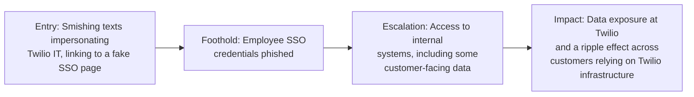

# Twilio "0ktapus" (2022) — Smishing Campaign to Downstream Customer Exposure

**Industry:** Communications / Technology (customer engagement platform)
**Disclosed impact:** Employee credentials phished via SMS, leading to unauthorized access to internal systems and data belonging to a limited number of Twilio customers; the same broader campaign hit well over a hundred organizations.

## In plain terms

Employees at Twilio received text messages that looked like they came from Twilio's own IT department, warning about a password expiring or a schedule change, with a link to a fake login page nearly identical to Twilio's real single sign-on portal. Some employees, working from mobile devices where such details are harder to catch, entered their credentials into the fake page. That was enough to get into internal systems, and because Twilio provides communication infrastructure (SMS, authentication tools) used by many other companies, the exposure didn't stop at Twilio's own walls.

## Stage-by-stage breakdown

**1. Entry Point.** Attackers ran a large-scale smishing (SMS phishing) campaign, later publicly tracked under names including "0ktapus" and "Scatter Swine," sending text messages to employees impersonating internal IT notifications, with links to convincing replica login pages designed to closely mimic Okta-style single sign-on portals used by many tech companies, including Twilio's own.

**2. Foothold.** A number of Twilio employees entered valid credentials into the fake pages, handing attackers legitimate access to internal authentication sessions.

**3. Escalation.** With valid employee credentials, attackers gained unauthorized access to certain internal Twilio systems. Twilio's public disclosure confirmed that a limited number of customer accounts had associated data accessed as a result. Because Twilio provides SMS and identity infrastructure used by other companies, the same broader smishing campaign is publicly reported to have also compromised employees at other technology companies during the same period, illustrating how a single technique run at scale against many organizations' employees can ripple across an entire supply chain of interconnected services.

**4. Impact.** Twilio disclosed unauthorized access affecting a defined set of customer accounts and notified affected customers directly. The wider campaign's significance goes beyond any single company's disclosed numbers: it demonstrated that a well-executed smishing campaign, run broadly enough, can compromise multiple links in a technology supply chain in the same window of time, using nearly identical tactics against each one.

## What should have stopped this, and where it's covered

- **Phishing-resistant authentication (hardware security keys / FIDO2)** — this is the single clearest lesson from this campaign, because other organizations targeted in the same broader campaign publicly confirmed they were unaffected specifically because employee logins required a physical hardware security key that cannot be phished the way a password and one-time code can. See [phishing-resistant MFA](../04-defensive-measures/README.md#technical-controls).
- **User-reported phishing culture for SMS, not just email** — mobile-targeted phishing is under-covered by most awareness training that focuses almost entirely on email. See [training that works](../04-defensive-measures/README.md#human-and-process-controls).
- **Rapid, coordinated incident communication to downstream customers**, which Twilio's disclosure process did carry out.

## Why this case earns its place here

This is the strongest available real-world evidence for a specific, concrete defensive recommendation: hardware-based, phishing-resistant multi-factor authentication directly prevented account compromise during this exact campaign at organizations that had already adopted it, while a traditional password-plus-one-time-code setup did not stop it elsewhere. It's rare to have such a clean natural experiment on which specific control actually works.

---
**Back to:** [03 — Real-World Escalation Case Studies](README.md)
