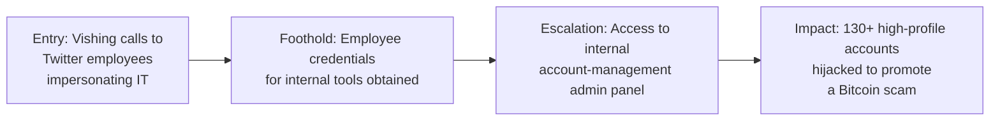

# Twitter (2020) — Vishing to Internal Admin Tool Takeover

**Industry:** Social media / Technology
**Disclosed impact:** Takeover of over 130 high-profile verified accounts (including major political figures, celebrities, and companies), used to run a Bitcoin scam.

## In plain terms

Attackers called Twitter employees on the phone, impersonating IT staff, to get them to hand over credentials for internal tools. It worked well enough on enough people that the attackers gained access to an internal administrative panel meant for customer support and account management. From there, taking over any account on the platform, including verified accounts belonging to some of the most-followed people and organizations in the world, was just a matter of using the tool the way support staff normally would.

## Stage-by-stage breakdown

**1. Entry Point.** According to Twitter's own public incident account and a subsequent California Department of Financial Protection and Innovation report, attackers conducted a targeted phone spear-phishing (vishing) campaign against Twitter employees, impersonating the IT department to obtain credentials for internal systems.

**2. Foothold.** With harvested credentials, attackers gained access to accounts belonging to employees with permissions to internal support tools.

**3. Escalation.** Critically, some of the compromised employees had access to an internal administrative tool used by Twitter's support and trust & safety teams to manage user accounts, including resetting associated email addresses and bypassing normal account security. This tool existed for legitimate support purposes (helping locked-out users, handling abuse reports), but its reach, combined with the breadth of employee access to it, meant that compromising the right employee credentials was functionally equivalent to compromising the entire user base.

**4. Impact.** Attackers used this access to take over more than 130 verified, high-profile accounts, including those of prominent political figures, celebrities, and major companies, posting a coordinated Bitcoin scam soliciting cryptocurrency payments. Beyond the direct financial fraud, the incident raised serious questions about the platform's ability to protect the integrity of accounts with genuine public and political significance.

## What should have stopped this, and where it's covered

- **Phishing-resistant, out-of-band identity verification for internal tool access** — a phone call alone should never be sufficient to grant or reset access to systems this sensitive. See [verification protocols](../04-defensive-measures/README.md#human-and-process-controls).
- **Tighter, role-based scoping of the admin tool itself** — too many support staff appear to have had access to a tool capable of affecting any account on the platform, rather than only the accounts relevant to their specific queue. See [least privilege](../04-defensive-measures/README.md#technical-controls).
- **Enhanced protections and alerting on high-profile/high-follower accounts specifically**, given their outsized potential for harm if compromised.

## Why this case earns its place here

Twitter shows how a single, well-executed vishing campaign against ordinary support staff can have consequences completely disproportionate to the technical sophistication involved. There was no malware, no exploit, no zero-day. Just phone calls, convincing pretexts, and an internal tool with a blast radius nobody had fully reckoned with.

---
**Back to:** [03 — Real-World Escalation Case Studies](README.md)
