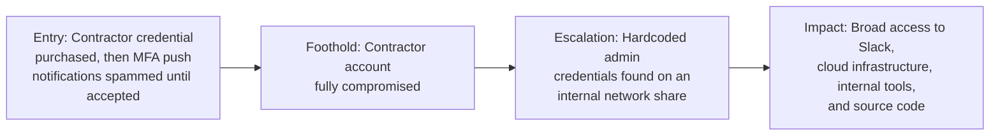

# Uber (2022) — MFA Fatigue and a Hardcoded Credential on a Shared Drive

**Industry:** Technology / Rideshare
**Disclosed impact:** Broad internal access to Uber's Slack, cloud infrastructure (AWS, GCP), internal tools, and source code repositories.

## In plain terms

An attacker got hold of a contractor's password, likely purchased from an earlier, unrelated malware infection. That password alone wasn't enough, because the account was protected by multi-factor authentication. So the attacker just made the contractor's phone buzz with login approval requests, over and over, for an extended period, until the contractor approved one to make it stop. That single approval was the entire breach. From there, the attacker found an internal network share containing a script with hardcoded administrator credentials for a privileged access management system, and used it to access nearly everything.

## Stage-by-stage breakdown

**1. Entry Point.** The attacker obtained valid login credentials for an Uber contractor, reportedly acquired from a credential-stealing malware infection unrelated to Uber directly. Because the account had multi-factor authentication enabled, a password alone wasn't sufficient. The attacker instead repeatedly triggered MFA push notification prompts to the contractor's phone over an extended period, a technique now widely known as "MFA fatigue" or "MFA bombing," until the contractor, likely assuming the repeated prompts were a system glitch or simply wanting them to stop, approved one.

**2. Foothold.** That single approval gave the attacker fully authenticated access to the contractor's account and Uber's internal VPN.

**3. Escalation.** Once inside, the attacker searched Uber's internal network and found a PowerShell script on a network share that contained hardcoded credentials for an administrator account on Uber's privileged access management (PAM) system, Thycotic. That single discovery converted one contractor's access into effectively unrestricted internal access, because the PAM system itself is designed to hold the credentials for many other internal systems.

**4. Impact.** With administrator-level PAM access, the attacker reportedly gained broad access to Uber's internal Slack workspace (where they publicly posted a message announcing the breach), Google Workspace admin console, AWS and GCP cloud environments, internal financial and travel systems, and source code repositories. Uber's public disclosure characterized the scope as extensive internal access, though the company stated no evidence emerged of unauthorized access to the production systems handling public-facing rider and driver services.

## What should have stopped this, and where it's covered

- **Phishing- and fatigue-resistant MFA (number-matching or hardware security keys instead of simple push-approve)** — a push notification that just requires tapping "approve" is exactly what makes MFA fatigue attacks possible; number-matching or FIDO2 hardware keys close this specific gap. See [phishing-resistant MFA](../04-defensive-measures/README.md#technical-controls).
- **No hardcoded credentials, anywhere, ever** — this is a basic secrets-management failure independent of the social engineering angle, but it's precisely what turned one compromised contractor account into a company-wide incident. See [privileged access hygiene](../04-defensive-measures/README.md#technical-controls).
- **Rate-limiting or automatic lockout on repeated MFA prompts**, and employee/contractor training that repeated, unexplained MFA prompts are themselves a red flag to report, not a nuisance to dismiss. See [Section 05](../05-guide-for-non-security-staff/README.md).

## Why this case earns its place here

Uber is the clearest illustration in this collection of a compounding failure: the social engineering (MFA fatigue) got the attacker in the door, but it was a completely unrelated hygiene failure (hardcoded admin credentials sitting on a shared drive) that turned a single compromised contractor account into what was, by the attacker's own public boasting, close to total internal access. Good MFA design would have stopped stage 1. Basic credential hygiene would have stopped stage 3, even if stage 1 had succeeded anyway. Neither control depended on the other, which is exactly why defense in depth matters.

---
**Back to:** [03 — Real-World Escalation Case Studies](README.md)
