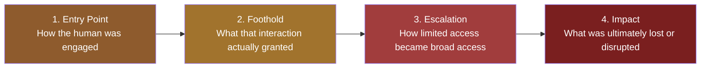
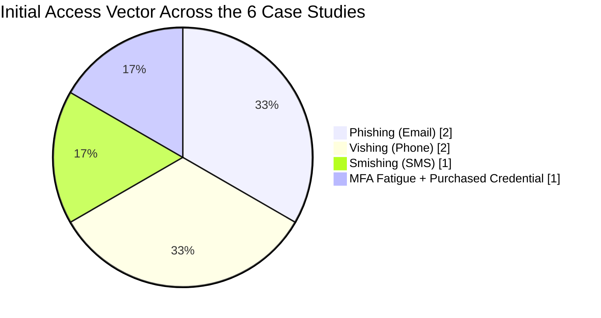
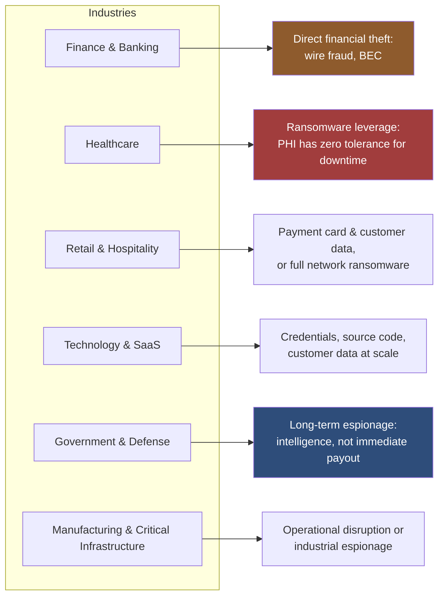
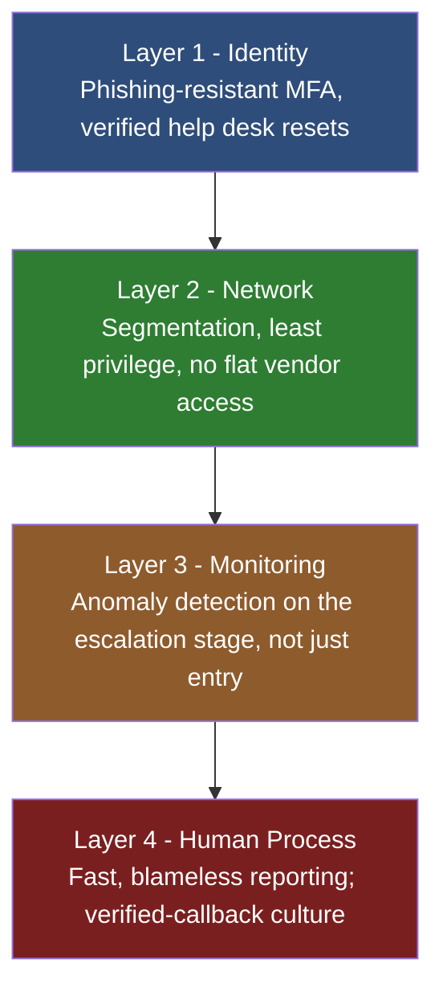

# 06 — Diagrams & Data

This section consolidates the visual models used throughout the project into one reference page, plus a breakdown of the initial-access vectors across all six case studies.

## The universal escalation kill chain

Every case study in Section 03 fits this same four-stage shape, regardless of industry or technique:

**Why stage 3 gets the most attention in this project:** stages 1 and 4 make the headlines, but stage 3 is where every single one of these breaches was actually still preventable. A phished credential that hits a segmented, least-privilege environment stays a minor incident. The same phished credential in a flat, over-permissioned environment becomes Target, RSA, Twitter, Twilio, Uber, or MGM/Caesars.

## Initial-access vectors across the six case studies

Two techniques, phishing and vishing, account for two-thirds of the entry points across every case in this project, despite spanning retail, defense supply chain, social media, communications, rideshare, and hospitality. This is the strongest evidence in this project that the defense priority should be channel-agnostic verification habits (see [Section 05](../05-guide-for-non-security-staff/README.md)), not narrow, technique-specific training that only covers whichever attack made the news most recently.

## Industry to primary goal mapping

Full reasoning behind each connection: [Section 02 — Goals by Industry](../02-goals-by-industry/README.md).

## Defense in depth: where each control actually sits

The point of drawing this as layers rather than a single wall: in every case study, at least one layer failed. The incidents that caused the least damage (relative to the sophistication of the attack) were the ones where a *different* layer caught what the first one missed. Twilio's broader campaign is the cleanest example: Layer 1 failed identically at multiple companies (employees were phished via SMS), but at organizations using hardware security keys, Layer 1 held anyway, because phishing-resistant MFA doesn't depend on the human recognizing the fake page at all.

## Full case comparison

| Case | Industry | Entry Vector | Escalation Mechanism | Disclosed Impact Scale |
|---|---|---|---|---|
| Target (2013) | Retail | Phishing (vendor) | Flat vendor-to-POS network access | ~40M card records |
| RSA (2011) | Security/Defense supply chain | Phishing (attachment) | Lateral movement to seed data | Global SecurID token replacement |
| Twitter (2020) | Social media/Tech | Vishing | Internal admin tool with broad reach | 130+ high-profile accounts hijacked |
| Twilio (2022) | Communications/Tech | Smishing | Credential reuse across a supply chain | Multiple companies affected in one campaign |
| Uber (2022) | Tech/Rideshare | MFA fatigue | Hardcoded PAM admin credential found | Broad internal system access |
| MGM/Caesars (2023) | Hospitality/Gaming | Vishing (help desk) | Privileged identity reset | ~$100M cost (MGM); ransom paid (Caesars) |

---
**Previous:** [← 05 — Guide for Non-Security Staff](../05-guide-for-non-security-staff/README.md)
**Back to:** [Main README](../README.md)
